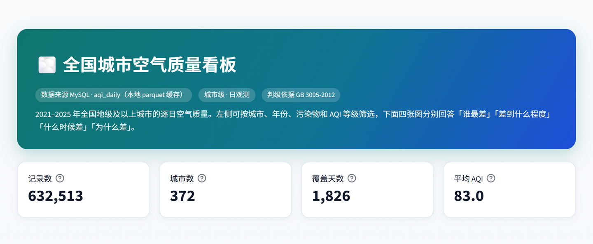
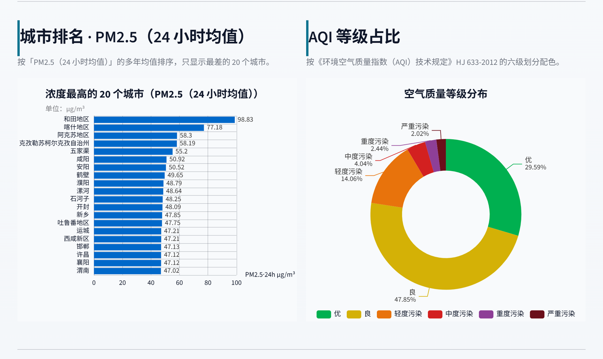

# 全国城市空气质量数据分析平台

把 2021–2025 年全国城市级的原始宽表（**城市在列上**、每天 15 类指标、共 378 列）
清洗成 **632,513 行 × 24 列**的日级事实表，存进 MySQL，再用 Streamlit + Pyecharts
做成可按 **城市 / 年份 / 污染物 / AQI 等级** 四维筛选的在线看板。

一句话：**从 5 个年度压缩包，到一条能在浏览器里点开的结论。**

看板里的每个数字都是页面实时算的，报告里的每个数字都由脚本产出——
`README` 不预写任何规模、耗时、排名、相关系数（理由见
[docs/findings.md](docs/findings.md) 的数字溯源表）。

---

## 看板预览



632,513 条城市-日记录 · 372 座城市 · 1,826 天 · 平均 AQI 83.0



左：最差 20 城（默认 PM2.5 24h 均值，可切污染物）；右：AQI 六级分布，用 HJ 633-2012 国标配色。


上：60 个月逐月均值；下：污染物相关系数热力图（最高 PM2.5·24h–PM10·24h **r=0.77**）。

---

## 快速开始

### 只想看结论 —— 0 条命令

打开 `reports/report.md`，11 节全在里面。

### 只想看看板 —— 2 条命令

```bash
pip install -r requirements.txt
streamlit run app/app.py     # 打开 http://localhost:8501
```

前提是 `data/processed/aqi_daily.csv.gz` 存在。**没有 MySQL 也能跑**，
看板会自动退回读本地文件（`app/app.py` 里的降级分支）。

### 从零复现全流程 —— 5 步

```bash
# 0. 装依赖
pip install -r requirements.txt

# 1. 原始 zip → 日级表（先 3 个日文件验证流程，再上全量）
python scripts/prepare_data.py --limit 3
python scripts/prepare_data.py

# 2. 从真实数据生成报告（所有数字的唯一来源）
python scripts/make_report.py          # → reports/report.md

# 3. 日级表 → MySQL（自动建表建索引，幂等：跑几遍行数都一样）
docker compose up -d mysql
python scripts/load_mysql.py

# 4. SQL 分析（5 条窗口函数查询，导出 CSV）
python scripts/run_queries.py --show

# 5. 起看板
streamlit run app/app.py
```

第 1 步需要自备原始数据：从 <https://quotsoft.net/air/> 下载
`城市_YYYY0101-YYYY1231.zip` 放到 `AQI_WORKSPACE`（默认 `D:\学习\全国空气质量`）。
文件形态与下载方式见 [docs/data_source.md](docs/data_source.md)。

### 整个环境一条命令

```bash
docker compose up -d          # MySQL + 应用一起起
docker compose logs -f app    # 排障第一步
```

---

## 它回答了什么

| 问题 | 结论 | 证据 |
|---|---|---|
| 五年有没有变好？ | **波动下降，但线性趋势不显著** —— 这是主结论 | 斜率 −0.3292 μg/m³/年，95% CI 跨 0，p=0.30 |
| 那改善在哪？ | **在结构上，不在均值上** | AQI 优 +15.7%；重度+严重 −13.8%；χ²=1431.4 |
| 差距最大的是什么？ | **城市之间，不是年份之间** | 和田 116.42 vs 阿里 5.39，**21.6 倍** |
| 臭氧恶化了吗？ | **没有**。而「O₃ 与 PM2.5 无关」是聚合假象 | 超标率 7.08%→4.67%；池化 r=−0.04，但城市间 **+0.47** |
| 所以现在该盯什么？ | **峰值与污染天，不是年均值** | 年均 29.87 已达标；但超标日 **66% 集中在 1/12/2 月** |

完整 10 条结论、分层相关、稳健性检验见 [docs/findings.md](docs/findings.md)。

---

## 技术栈

`Python 3.14` · `pandas 3.0` · `MySQL 8` · `Streamlit` · `Pyecharts` · `Docker Compose` · `pytest`

分析口径（为什么 AQI 取 max、`_24h` 取 last、缺失不填 0）见
[docs/decisions.md](docs/decisions.md) 的 D-007。

---

## SQL 分析

`sql/queries.sql` 里 5 条查询，`python scripts/run_queries.py --show` 跑完导出到 `reports/queries/`：

| name | 用到的能力 | 回答什么问题 |
|---|---|---|
| `city_rank_pm25` | `RANK() OVER` | 各城市 PM2.5 年均排名 |
| `yoy_change` | `LAG() OVER` | 同比变化，治理有没有效果 |
| `o3_trend` | 条件聚合 | 臭氧超标率逐年走势 |
| `rolling_7d` | `ROWS BETWEEN 6 PRECEDING` | 西安 7 日滑动均值 |
| `exceed_days` | 与国标限值比较 | **各城市**（表里没有省份字段）超标天数 |

---

## 目录

```
aqi-insight/
├── src/            config / zipsource / cleaning / pipeline / aqi / stats / regions / db
├── scripts/        prepare_data · make_report · load_mysql · run_queries
├── sql/            01_create · 02_index · queries（5 条窗口函数查询）
├── app/app.py      Streamlit + Pyecharts 看板
├── tests/          pytest 用例（含一个故意失败的练习用例）
├── docs/           结论 / 决策 / 踩坑 / 运行日志 / 限制
├── Dockerfile · docker-compose.yml
└── reports/        report.md · data_quality.md · queries/*.csv
```

---

## 已知限制

1. **外网访问不了** —— 本机在 `10.40.28.209/16` 私有网段，NAT 后面；三国节点实测 TCP 全超时。
   对外演示要走隧道或云服务器，本地 `localhost:8501` 正常。
2. **未计算「首要污染物」** —— 表里只有各污染物浓度与 AQI，没有逐日判定谁占主导。
3. **`o3_24h` 结构性缺失** —— 2024 年 100%、2025 年 86.87%，跨年不可比。

其余 9 条见 [docs/limitations.md](docs/limitations.md)。

---

## 文档

| 文件 | 内容 |
|---|---|
| [docs/findings.md](docs/findings.md) | 10 条实测结论 + 数字溯源表 |
| [docs/decisions.md](docs/decisions.md) | 分析口径决策记录（为什么这么算） |
| [docs/engineering.md](docs/engineering.md) | 9 个真实踩坑 + 测试策略 |
| [docs/limitations.md](docs/limitations.md) | 12 条已知限制 |
| [docs/data_source.md](docs/data_source.md) | 数据来源、文件形态、粒度取舍 |
| [docs/run-log.md](docs/run-log.md) | 每次真实运行记录（命令 / 耗时 / 失败与修复） |
| [reports/report.md](reports/report.md) | 脚本生成的完整分析报告 |